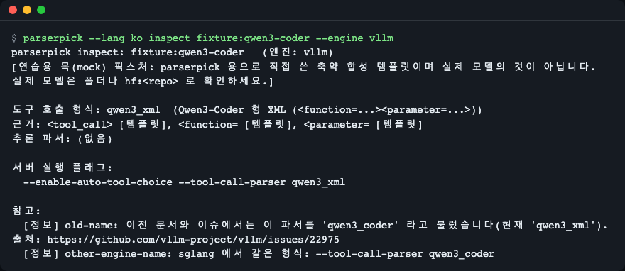
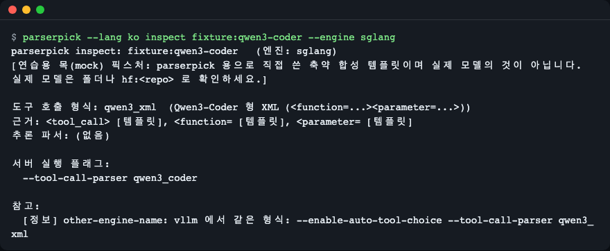
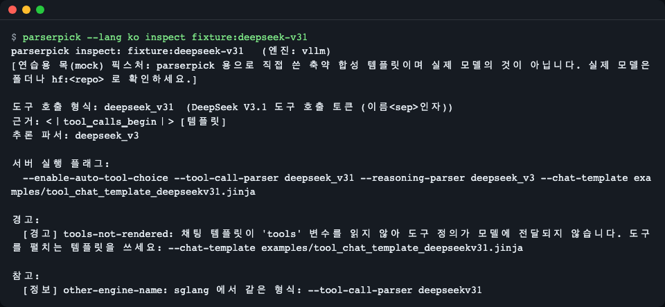
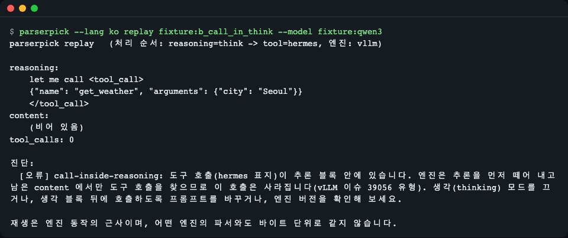
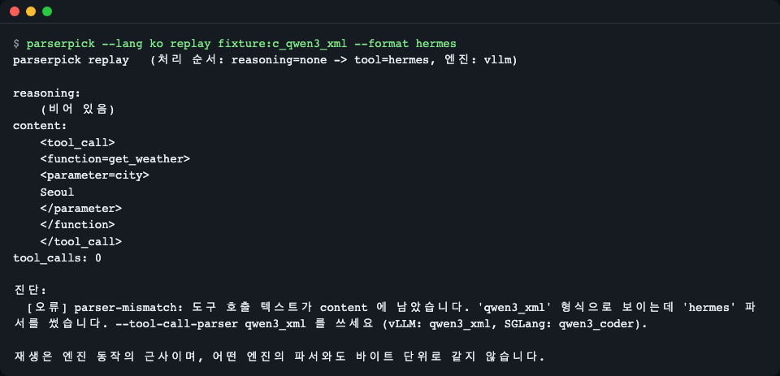
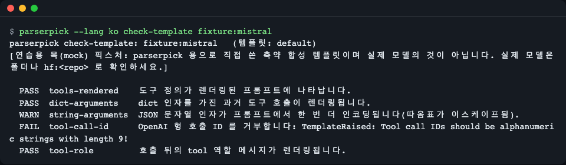
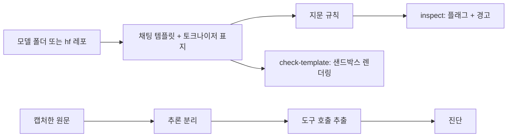

# parserpick

[English](README.md) | **한국어**

모델의 채팅 템플릿을 읽어 vLLM·SGLang 에 줄 `--tool-call-parser`, `--reasoning-parser`, `--chat-template` 플래그를 서버를 띄우기 **전에** 골라 줍니다. 도구 호출이 사라지면 서버에서 캡처한 원문을 오프라인으로 다시 돌려 어디로 샜는지 보여 줍니다. GPU, 서버, API 키가 필요 없습니다.


*`parserpick inspect` 가 템플릿을 읽어 도구 호출 형식을 알려 주고 서버 실행 플래그를 출력합니다. 내장 연습용(목) 템플릿으로 실행한 화면입니다.*

## 이런 분께

- 새 오픈 모델(또는 직접 파인튜닝한 모델)을 vLLM·SGLang 으로 띄우려는데 모델별 파서 표를 뒤지기 싫은 분
- 에이전트가 `tool_calls: []` 를 받고, 호출 문장이 `content` 나 추론(reasoning) 블록 안에 보여서 이유를 알고 싶은 분
- 엔진을 바꾸거나(vLLM ↔ SGLang) 업그레이드했더니 파서 이름이 달라진 분
- 채팅 템플릿을 고친 뒤 도구 정의와 과거 도구 호출이 아직 잘 렌더링되는지 빠르게 확인하고 싶은 분

## 설치

```bash
# 전제: uv (https://docs.astral.sh/uv/), 알맞은 Python(3.11+)도 uv 가 받아 옵니다
curl -LsSf https://astral.sh/uv/install.sh | sh
# parserpick 설치 (최소 리눅스 이미지에는 git·curl 필요: apt-get install -y git curl)
uv tool install git+https://github.com/LeeGyeongPil/parserpick
```

설치 없이 써 보기: `uvx --from git+https://github.com/LeeGyeongPil/parserpick parserpick demo`.
clone 해서 쓰기: `git clone https://github.com/LeeGyeongPil/parserpick && cd parserpick && uv run parserpick demo`.

실행 의존성은 `jinja2` 하나입니다.

## 빠르게 시작하기

먼저 오프라인 시연을 돌려 보세요. 내장 **연습용(목, mock) 픽스처**를 씁니다. parserpick 용으로 직접 쓴 짧은 합성 템플릿과 캡처 원문이고, 실제 모델의 복사본이 아닙니다. 실제 모델 폴더와 같은 코드 경로를 거치지만 실제 템플릿은 더 길기 때문에, 플래그는 실제 모델로 한 번 더 확인하세요.

```bash
parserpick demo
```

그다음 내 모델(로컬 폴더나 Hugging Face 레포)에 대고 실행합니다.

```bash
parserpick inspect ./my-model
parserpick inspect hf:Qwen/Qwen3-Coder-30B-A3B-Instruct --engine sglang
```

Qwen3-Coder 형 템플릿이 든 폴더(SGLang) 출력:

```text
parserpick inspect: my-model   (engine: sglang)

Tool-call format: qwen3_xml  (Qwen3-Coder XML (<function=...><parameter=...>))
Evidence: <tool_call> [template], <function= [template], <parameter= [template]
Reasoning parser: (none)

Serve with:
  --tool-call-parser qwen3_coder

Notes:
  [INFO] other-engine-name: Same format on vllm: --enable-auto-tool-choice --tool-call-parser qwen3_xml
```

위는 영어 화면입니다. 한국어 화면은 `--lang ko` 또는 `PARSERPICK_LANG=ko` 로 바꿉니다(아래 스크린샷).

- **도구 호출 형식(Tool-call format)**: 모델이 도구를 부를 때 쓰는 글자 모양입니다. 모델 이름이 아니라 템플릿·토크나이저의 표지로 판정하므로 이름을 바꾼 파인튜닝 모델도 같은 답이 나옵니다.
- **근거(Evidence)**: 판정을 정한 표지입니다. `<tool_call>` 하나면 Hermes 형이고, `<function=`·`<parameter=` 가 함께 있으면 Qwen3-Coder XML 형입니다.
- **실행 플래그(Serve with)**: `vllm serve` 나 SGLang 실행 명령에 붙여 넣으세요. 같은 형식이라도 엔진마다 파서 이름이 달라서(vLLM `qwen3_xml`, SGLang `qwen3_coder`) 엔진을 지정해야 합니다. 그 엔진 문서에 파서 이름이 없는 형식은 도구 호출 플래그를 아예 내지 않고 `no-engine-parser` 경고만 냅니다(vLLM 은 `--tool-call-parser` 없이 `--enable-auto-tool-choice` 를 받으면 기동을 거부합니다).


*같은 템플릿에 `--engine sglang`: 파서 이름이 `qwen3_coder` 로 바뀝니다.*

## 사용법

| 명령 | 하는 일 | 예 |
|---|---|---|
| `parserpick inspect SOURCE` | 형식 판정, 서버 플래그와 경고 출력 | `parserpick inspect ./my-model --engine vllm` |
| `parserpick replay CAPTURE` | 캡처 원문 재생: 추론 분리, 도구 호출 추출, 진단 | `parserpick replay capture.txt --model ./my-model` |
| `parserpick check-template SOURCE` | 도구 호출 클라이언트가 보내는 메시지 5종으로 템플릿 렌더링 시험 | `parserpick check-template ./my-model` |
| `parserpick demo` | 연습용 픽스처로 오프라인 시연 | `parserpick demo` |

`SOURCE` 는 모델 폴더(`tokenizer_config.json` 또는 `chat_template.jinja` 가 있는 곳), `hf:<org>/<repo>[@revision]`, `fixture:<name>`(내장 연습용 템플릿)입니다. `CAPTURE` 는 텍스트 파일, `/v1/completions` JSON 응답, `fixture:<name>` 입니다.

공통 옵션: `--engine vllm|sglang`(기본 `vllm`), `--engine-version V`(표를 확인한 버전과 다르면 경고), `replay` 의 `--format NAME`·`--reasoning NAME`(vLLM·SGLang·옛 이름 모두 가능), 기계가 읽는 `--json`, `--lang en|ko`.

종료 코드: `0` 정상, `1` 문제 발견(FAIL, 오류 등급 진단, 형식 판정 불가), `2` 입력 오류, `4` 다운로드 실패. 그래서 `check-template`·`replay` 를 CI 에 넣을 수 있습니다.

### 시나리오 1: 템플릿이 모델에게 도구를 보여 주지 않는 경우

```bash
parserpick inspect fixture:deepseek-v31
```


*플래그에 도구를 렌더링하는 `--chat-template` 이 들어가고, 경고가 이유를 알려 줍니다. 이 템플릿은 `tools` 를 읽지 않아서 모델이 도구 정의를 전혀 보지 못합니다. `examples/...` 경로는 vLLM 소스 저장소 안의 파일입니다([examples 폴더](https://github.com/vllm-project/vllm/tree/main/examples)). 받아서 그 경로를 넘기세요. SGLang 템플릿은 그 저장소의 `examples/chat_template/` 에 있습니다.*

### 시나리오 2: 호출이 생각(think) 블록 안에 들어간 경우

서버가 만든 원문(예: `/v1/completions` 응답)을 파일로 저장해 재생합니다. 내장 캡처 `b_call_in_think` 가 그 역할을 대신합니다.

```bash
parserpick replay fixture:b_call_in_think --model fixture:qwen3
```


*엔진은 추론을 먼저 떼어 내고 남은 부분에서만 도구 호출을 찾습니다. `<think>` 안에 쓴 호출은 사라지며 진단은 `call-inside-reasoning` 입니다.*

### 시나리오 3: 틀린 파서를 고른 경우

```bash
parserpick replay fixture:c_qwen3_xml --format hermes
```


*틀린 파서로도 서버는 조용히 뜨고 `tool_calls: 0` 만 돌려줍니다. `parser-mismatch` 가 맞는 파서 이름을 두 엔진 모두로 알려 줍니다.*

### 시나리오 4: 도구 클라이언트의 메시지 모양으로 템플릿 시험

```bash
parserpick check-template fixture:mistral
```


*템플릿을 Jinja 샌드박스에서 메시지 5종으로 렌더링합니다. 여기서는 OpenAI 형 호출 ID 가 거부되고(FAIL) JSON 문자열 arguments 가 두 번 이스케이프됩니다(WARN).*

replay 진단 코드: `call-inside-reasoning`, `parser-mismatch`, `broken-arguments`, `unclosed-call`(`max_tokens` 나 stop 문자열 때문인 경우가 많음), `no-call`, `text-mixed-pythonic`.

## 설정

parserpick 은 키도 GPU 도 필요 없습니다. 아래는 모두 선택입니다([`.env.example`](.env.example) 참고).

| 변수 | 용도 |
|---|---|
| `PARSERPICK_LANG` | 화면 언어 `en` 또는 `ko`. 순서: `--lang`, 이 변수, `LC_ALL`, `LC_MESSAGES`, `LANG`, 그 외는 영어 |
| `HF_TOKEN` | `hf:` 소스로 접근 제한(gated) 레포를 받을 때 쓰는 Bearer 토큰 |
| `HF_ENDPOINT` | Hugging Face 기본 주소나 미러(기본 `https://huggingface.co`) |

호출마다 언어 바꾸기: `parserpick --lang ko inspect fixture:qwen3`. JSON 출력의 키와 코드는 언어와 무관하고 `message` 만 번역됩니다.

형식 표([지원 형식](#지원-형식) 참고)는 `src/parserpick/data/formats.toml` 에 있습니다. 파서 이름은 2026-11-19 에 vLLM 0.34.0 과 SGLang 0.5.23 문서로 확인했고, 항목마다 확인 날짜가 있습니다. 계열을 추가하려면 이 파일에 데이터를 더하고 `fingerprint.py` 에 규칙 한 줄을 더하고, 두 메시지 표(`locales/en.json`, `locales/ko.json`)에 `format.<family>.label` 항목을 더합니다.

## 동작 원리



1. 폴더에서 템플릿과 특수 토큰을 읽습니다(`hf:` 는 일반 HTTPS GET 으로 받습니다).
2. 지문 규칙이 여러 표지를 우선순위로 조합합니다. `<tool_call>` 만 있으면 Hermes, `<arg_key>` 가 함께 있으면 GLM, `<function=`·`<parameter=` 가 함께 있으면 Qwen3-Coder 입니다.
3. 형식은 데이터 표에서 엔진·버전별 파서 이름으로 바뀌고, 문서에 없는 이름은 추측하지 않고 없다고 알립니다.
4. `replay` 는 엔진의 순서를 따릅니다. 추론을 먼저 분리하고 나머지에서 도구 호출을 추출합니다. 그래서 `<think>` 안의 호출이 사라집니다.
5. `replay` 는 엔진 동작을 근사할 뿐 어떤 엔진의 파서와도 바이트 단위로 같지 않습니다. 고친 뒤에는 실제 서버로 확인하세요.

## 지원 형식

도구 호출 계열 12개입니다. "판정 표지"는 parserpick 이 템플릿이나 토크나이저에서 찾는 주요 표지입니다. "replay" 는 그 계열의 원문에서 `parserpick replay` 가 호출을 추출할 수 있는지 뜻하고, 나머지 셋은 `inspect` 로만 판정합니다. `-` 는 문서에 그 계열의 추론 파서가 없다는 뜻이고, "문서화된 이름 없음"은 엔진 문서에 파서가 없다는 뜻입니다(parserpick 은 그 엔진에 도구 호출 플래그를 내지 않고, vLLM 에서는 `--enable-auto-tool-choice` 도 뺍니다. 추측하지 않고 경고합니다). 이 중 일부는 엔진 코드에 이름이 있지만(vLLM `minimax_m2`, SGLang `minimax-m2`) 문서에 없고 replay 로 확인하지 않아 아직 권하지 않습니다.

| 계열(예시 모델) | 판정 표지 | vLLM `--tool-call-parser` | SGLang `--tool-call-parser` | 추론 파서(vLLM / SGLang) | replay |
|---|---|---|---|---|---|
| `hermes` (Qwen2.5, Qwen3, Hermes) | `<tool_call>` | `hermes` | `qwen` | `qwen3` / `qwen3` | 가능 |
| `qwen3_xml` (Qwen3-Coder) | `<tool_call>` + `<function=` + `<parameter=` | `qwen3_xml` | `qwen3_coder` | - | 가능 |
| `glm45` (GLM-4.5, 4.6) | `<tool_call>` + `<arg_key>` | `glm45` | `glm` | `glm45` / - | 가능 |
| `llama3_json` (Llama 3.1-3.3) | `<\|python_tag\|>`, `"parameters"` | `llama3_json` | `llama3` | - | 가능 |
| `pythonic` (Llama 4, ToolACE) | `[func(...)]` 호출 목록 | `pythonic` | `pythonic` | - | 가능 |
| `mistral` (Mistral-7B v0.3) | `[TOOL_CALLS]` | `mistral` | `mistral` | - | 가능 |
| `deepseek_v3` (V3, R1) | 도구 호출 토큰 + `function<sep>` | `deepseek_v3` | `deepseekv3` | `deepseek_r1` / `deepseek-r1` | 가능 |
| `deepseek_v31` (V3.1) | 도구 호출 토큰, 이름 다음 인자 | `deepseek_v31` | `deepseekv31` | `deepseek_v3` / `deepseek-v3` | 가능 |
| `kimi_k2` (Kimi-K2) | `<\|tool_calls_section_begin\|>` | `kimi_k2` | `kimi_k2` | - | 가능 |
| `openai` (gpt-oss) | `<\|channel\|>` (harmony) | `openai` | `gpt-oss` | `openai_gptoss` / `gpt-oss` | 불가 |
| `granite` (Granite 3.x) | `<\|tool_call\|>` | `granite` | 문서화된 이름 없음 | - | 불가 |
| `minimax` (MiniMax-M2) | `<minimax:tool_call>` | 문서화된 이름 없음 | 문서화된 이름 없음 | `minimax_m2_append_think` / - | 불가 |

같은 형식도 두 엔진의 이름이 다릅니다(`qwen3_xml` 대 `qwen3_coder`, `hermes` 대 `qwen`, `glm45` 대 `glm`, `deepseek_v31` 대 `deepseekv31`, `openai` 대 `gpt-oss`). 2026-11-19 에 vLLM 0.34.0 과 SGLang 0.5.23 문서로 확인했습니다: [vLLM 도구 호출](https://docs.vllm.ai/en/latest/features/tool_calling/), [SGLang 도구 파서](https://docs.sglang.io/advanced_features/tool_parser.html). 기준 데이터는 [`formats.toml`](src/parserpick/data/formats.toml) 입니다.

## 언제 쓰나

- 잘 맞는 경우: 모델의 서버 플래그를 고르거나 다시 확인할 때, 저장한 원문으로 샌 도구 호출을 디버깅할 때, 템플릿 수정을 CI 에서 점검할 때
- 실행 중인 서버와는 통신하지 않습니다. 떠 있는 OpenAI 호환 엔드포인트를 HTTP 로 시험하려면 [toolcall-conformance](https://github.com/LeeGyeongPil/toolcall-conformance) 를 쓰세요. parserpick 은 서버를 띄우기 전 단계를 맡습니다.
- 판정은 내장 12개 템플릿 계열과 2026-11-19 에 받은 실제 Hugging Face 템플릿 일부로 확인했습니다. 새 모델 계열은 규칙이 추가되기 전까지 `unknown-format`(종료 코드 1)이 나올 수 있습니다.

## 한계

- **근사 재생.** `replay` 는 엔진 파서를 참고 없이 새로 구현한 근사이며 바이트 단위로 같지 않습니다. 고친 뒤에는 실제 서버로 확인하세요.
- **스트리밍 없음.** 증분(스트리밍) 파싱은 재현하지 않으므로 `stream=true` 에서만 생기는 버그는 `replay` 에 나타나지 않습니다.
- **replay 는 9개 형식.** `openai`(harmony)·`granite`·`minimax` 는 `inspect` 로만 판정하며 replay 는 다음 버전에서 다룰 예정입니다.
- **이름은 바뀔 수 있음.** 파서 이름은 위 확인 날짜 기준이고 엔진 버전마다 바뀔 수 있습니다. 표를 확인한 적 없는 버전을 `--engine-version` 으로 주면 경고가 나옵니다.
- **처음 보는 템플릿.** 규칙이 없는 템플릿은 추측하지 않고 `unknown-format` 이나 `ambiguous` 로 알립니다.
- **실제 템플릿은 동봉하지 않음.** 내장 픽스처는 짧은 합성 목(mock)입니다. `--chat-template` 플래그의 `examples/...` 경로는 설치한 곳이 아니라 vLLM(또는 SGLang) 소스 저장소 안의 파일입니다. 서버가 도는 곳에 그 파일이 없으면 서버가 뜨지 않습니다.
- **끝나지 않는 템플릿은 약 5초 뒤 중단.** `check-template` 은 렌더링을 별도 Python 프로세스의 Jinja 샌드박스에서 돌리며, 다섯 검사가 렌더링 시간 5초를 함께 씁니다. 끝없이 도는 템플릿은 약 5초 뒤(측정 5.2초) 첫 검사가 FAIL(멈춤), 나머지 네 검사가 FAIL(실행 안 함)으로 끝납니다. 출력 없이 도는 루프처럼 프로세스 안 예산이 닿지 않는 경우는 7초에 강제 종료되어 같은 모양으로 끝납니다(측정 7.1초). 템플릿 전체가 렌더링에 실패하면(예: RecursionError) 검사별 원인 대신 모든 검사가 FAIL(렌더링 실패)로 나옵니다. 메모리는 제한하지 않으며 시간 제한과 출력 100만 자 제한만 있습니다.
- **인코딩.** 템플릿·설정 파일은 UTF-8 이어야 하며, 아니면 파일 이름이 담긴 메시지와 함께 종료 코드 2 로 끝납니다.

## 관련 프로젝트

- [toolcall-conformance](https://github.com/LeeGyeongPil/toolcall-conformance): 떠 있는 OpenAI 호환 서버를 HTTP 로 검사합니다. parserpick 이 앞 단계입니다. 플래그를 고르고 템플릿을 먼저 확인한 뒤, 띄운 서버를 시험하세요.

## 자주 겪는 문제

| 증상 | 원인 | 해결 |
|---|---|---|
| `inspect` 가 `unknown-format` 으로 종료 코드 1 | 템플릿 형식에 맞는 규칙이 없음 | `--format` 을 직접 주고 replay 하거나 `formats.toml` 에 계열 추가 |
| 확인하지 않은 엔진 버전 경고 | `--engine-version` 이 표를 확인한 적 없는 minor 버전 | 그 버전 엔진 문서에서 이름 확인(경고에 근거 링크가 붙음) |
| `no-engine-parser` 경고 | 그 엔진 문서에 이 형식의 파서 이름이 없어 도구 호출 플래그를 내지 않음 | vLLM 은 파서 없이 도구가 담긴 `tool_choice` auto·required 요청을 거부하고, SGLang 은 호출이 `content` 텍스트로 돌아옴. 다른 엔진이나 사용자 정의 파서 플러그인 사용 |
| `--chat-template tool_use` 로 서버가 안 뜸 | 두 엔진 모두 `--chat-template` 값을 파일 경로로 읽음 | vLLM: 플래그를 빼기(도구 요청에는 `tool_use` 를 알아서 고름), SGLang: `--hf-chat-template-name tool_use`(parserpick 이 이렇게 출력) |
| `hf:` 다운로드 실패(종료 코드 4) | 접근 제한 레포, 네트워크, 프록시 | `HF_TOKEN`·`HF_ENDPOINT` 설정, 또는 폴더를 받아 경로로 지정 |
| 호출이 있는 텍스트인데 `replay` 가 `no-call` | `--format` 이 틀렸거나 `--reasoning` 규칙이 삼킴 | `--model SOURCE` 로 템플릿에서 형식·추론 규칙을 가져오기 |
| 터미널이 한국어로 나옴 | `LANG` 이 한국어 | `--lang en` 또는 `PARSERPICK_LANG=en` |

## 개발·기여

```bash
uv run pytest -q
```

네트워크 테스트는 기본으로 건너뜁니다(`pytest -m network` 로 실행). 버그·제안은 이슈로 남겨 주세요. 변경 기록은 [CHANGELOG.md](CHANGELOG.md).

## 라이선스

MIT, [LICENSE](LICENSE) 참고. 내장 픽스처는 이 프로젝트용으로 직접 쓴 합성 텍스트이며 모델 가중치나 제3자 템플릿 원문은 포함하지 않습니다.
