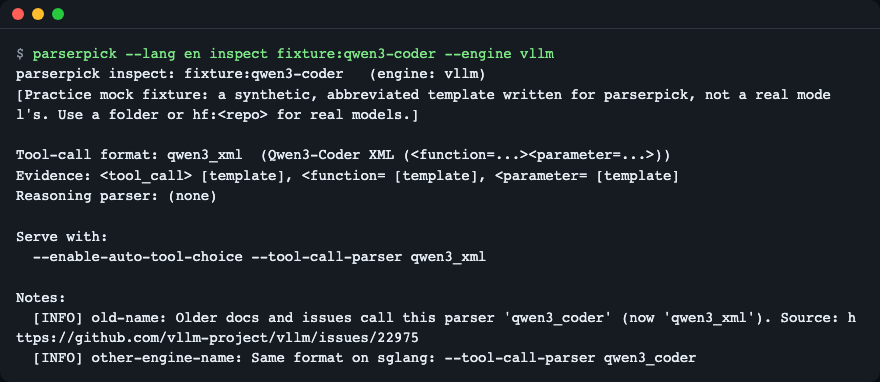
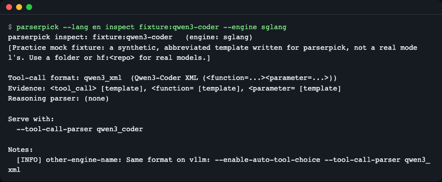
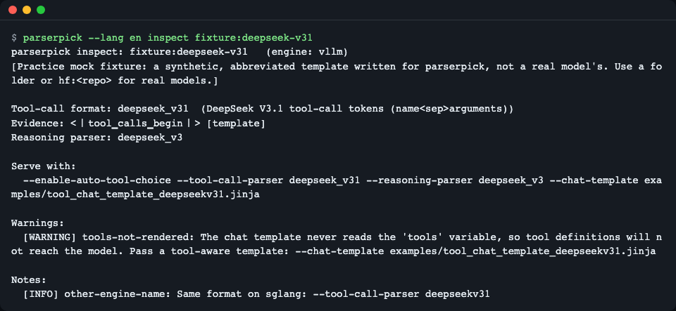
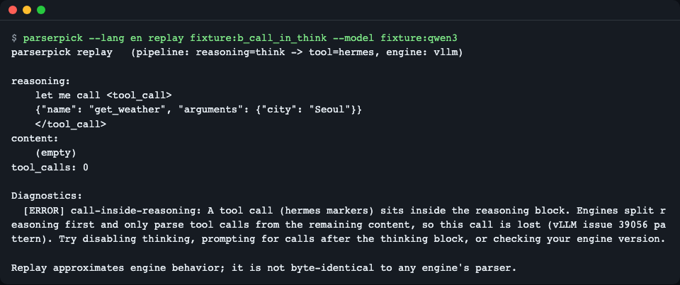
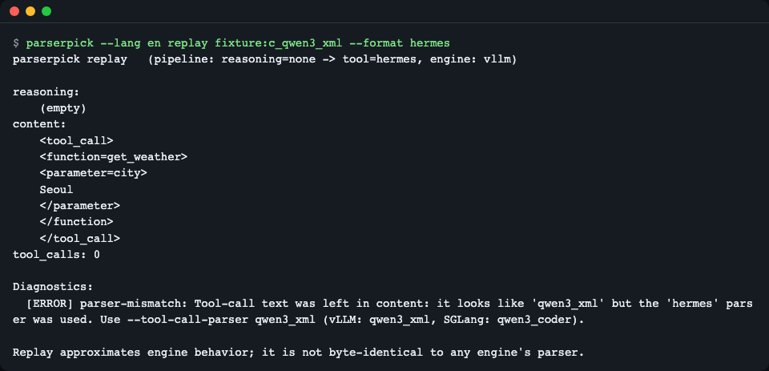
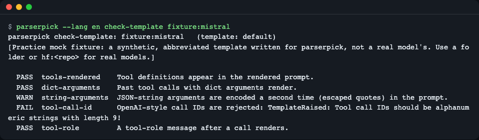
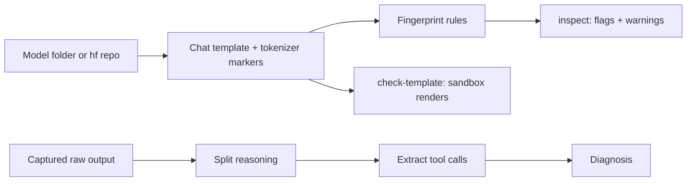

# parserpick

**English** | [한국어](README.ko.md)

Pick the right `--tool-call-parser`, `--reasoning-parser` and `--chat-template` flags for vLLM or SGLang from a model's chat template, before you start the server. When a tool call goes missing, replay the raw output offline and see where it leaked. No GPU, no server, no API key.


*`parserpick inspect` reads a template, names the tool-call format, and prints the flags to serve with. This run uses a built-in practice (mock) template.*

## Who is this for

- You are about to serve a new open model (or your own fine-tune) with vLLM or SGLang and do not want to dig through a per-model parser table.
- Your agent gets `tool_calls: []` and the call text shows up in `content` or inside the reasoning block, and you want to know why.
- You switched engine (vLLM to SGLang) or upgraded, and parser names changed.
- You changed a chat template and want a quick check that tool definitions and past tool calls still render.

## Install

```bash
# prerequisite: uv (https://docs.astral.sh/uv/), it also fetches a suitable Python (3.11+)
curl -LsSf https://astral.sh/uv/install.sh | sh
# parserpick itself (needs git on a minimal Linux image: apt-get install -y git curl)
uv tool install git+https://github.com/LeeGyeongPil/parserpick
```

Try it without installing: `uvx --from git+https://github.com/LeeGyeongPil/parserpick parserpick demo`.
Or from a clone: `git clone https://github.com/LeeGyeongPil/parserpick && cd parserpick && uv run parserpick demo`.

The only runtime dependency is `jinja2`.

## Quick start

Run the offline walkthrough first. It uses built-in **practice (mock) fixtures**: short synthetic templates and captured outputs written for parserpick, not copies of real models. They go through the same code paths as real model folders, but the real templates are longer, so check a real model before you trust a flag line.

```bash
parserpick demo
```

Then point it at your own model, a local folder or a Hugging Face repo:

```bash
parserpick inspect ./my-model
parserpick inspect hf:Qwen/Qwen3-Coder-30B-A3B-Instruct --engine sglang
```

Output for a folder holding a Qwen3-Coder-style template (SGLang):

```text
parserpick inspect: my-model   (engine: sglang)

Tool-call format: qwen3_xml  (Qwen3-Coder XML (<function=...><parameter=...>))
Evidence: <tool_call> [template], <function= [template], <parameter= [template]
Reasoning parser: (none)

Serve with:
  --tool-call-parser qwen3_coder

Notes:
  [INFO] other-engine-name: Same format on vllm: --enable-auto-tool-choice --tool-call-parser qwen3_xml
```

- **Tool-call format**: which text shape the model writes when it calls a tool. It is decided from markers in the template and tokenizer, never from the model name, so a renamed fine-tune gets the same answer.
- **Evidence**: the markers that decided it. `<tool_call>` alone would mean Hermes style; together with `<function=` and `<parameter=` it means the Qwen3-Coder XML style.
- **Serve with**: paste these flags into your `vllm serve` or SGLang launch command. The same format has different parser names per engine (`qwen3_xml` on vLLM, `qwen3_coder` on SGLang), which is why the engine matters. Formats with no parser name in that engine's docs get no tool-call flags at all (vLLM refuses to start when `--enable-auto-tool-choice` comes without `--tool-call-parser`), only a `no-engine-parser` warning.


*Same template, `--engine sglang`: the parser name changes to `qwen3_coder`.*

## Usage

| Command | What it does | Example |
|---|---|---|
| `parserpick inspect SOURCE` | Judge the format, print serve flags and warnings | `parserpick inspect ./my-model --engine vllm` |
| `parserpick replay CAPTURE` | Re-run captured raw output: split reasoning, extract tool calls, diagnose | `parserpick replay capture.txt --model ./my-model` |
| `parserpick check-template SOURCE` | Render the template with five message shapes tool clients send | `parserpick check-template ./my-model` |
| `parserpick demo` | Offline walkthrough on practice fixtures | `parserpick demo` |

`SOURCE` is a model folder (with `tokenizer_config.json` and/or `chat_template.jinja`), `hf:<org>/<repo>[@revision]`, or `fixture:<name>` (built-in practice template). `CAPTURE` is a text file, a `/v1/completions` JSON response, or `fixture:<name>`.

Common options: `--engine vllm|sglang` (default `vllm`), `--engine-version V` (warns if it differs from the versions the table was checked against), `--format NAME` and `--reasoning NAME` for `replay` (vLLM, SGLang and older names all work), `--json` for machine-readable output, `--lang en|ko`.

Exit codes: `0` fine, `1` a problem was found (FAIL, an error-level diagnosis, or an unknown format), `2` bad input, `4` download failed. This makes `check-template` and `replay` usable in CI.

### Scenario 1: a template that never shows tools to the model

```bash
parserpick inspect fixture:deepseek-v31
```


*The flags include a tool-aware `--chat-template`, and the warning says why: this template never reads `tools`, so the model would never see your tool definitions. The `examples/...` path is a file inside the vLLM source repository (see its [examples folder](https://github.com/vllm-project/vllm/tree/main/examples)); download it and pass its path. SGLang's templates live in its repository's `examples/chat_template/`.*

### Scenario 2: the call is inside the thinking block

Save the raw text the server produced (for example from `/v1/completions`) into a file and replay it. The built-in capture `b_call_in_think` stands in for that:

```bash
parserpick replay fixture:b_call_in_think --model fixture:qwen3
```


*Engines split reasoning first and parse tool calls only from what remains, so a call written inside `<think>` is lost. The diagnosis is `call-inside-reasoning`.*

### Scenario 3: the wrong parser was chosen

```bash
parserpick replay fixture:c_qwen3_xml --format hermes
```


*The server still starts with a wrong parser, it just returns `tool_calls: 0`. `parser-mismatch` names the parser that fits, for both engines.*

### Scenario 4: check a template for tool-client message shapes

```bash
parserpick check-template fixture:mistral
```


*The template is rendered in Jinja's sandbox with five message shapes. Here OpenAI-style call IDs are rejected (FAIL) and JSON-string arguments are escaped twice (WARN).*

Replay diagnostics: `call-inside-reasoning`, `parser-mismatch`, `broken-arguments`, `unclosed-call` (often `max_tokens` or a stop string), `no-call`, `text-mixed-pythonic`.

## Configuration

parserpick needs no key and no GPU. Everything is optional (see [`.env.example`](.env.example)):

| Variable | Purpose |
|---|---|
| `PARSERPICK_LANG` | UI language `en` or `ko`. Order: `--lang`, then this, then `LC_ALL`, `LC_MESSAGES`, `LANG`, otherwise English. |
| `HF_TOKEN` | Bearer token for gated Hugging Face repos with `hf:` sources. |
| `HF_ENDPOINT` | Hugging Face base URL or mirror (default `https://huggingface.co`). |

Switch language per call: `parserpick --lang ko inspect fixture:qwen3`. JSON output keeps keys and codes language-independent; only `message` is translated.

The format table (see [Supported formats](#supported-formats)) lives in `src/parserpick/data/formats.toml`. Parser names were checked against the vLLM 0.34.0 and SGLang 0.5.23 documentation on 2026-11-19; each entry carries its check date. Adding a family is a data change there plus one rule in `fingerprint.py` and a `format.<family>.label` entry in both message tables (`locales/en.json`, `locales/ko.json`).

## How it works



1. The template and special tokens are read from the folder (or downloaded with plain HTTPS GETs for `hf:`).
2. Fingerprint rules combine several markers by priority. `<tool_call>` alone is Hermes, `<tool_call>` plus `<arg_key>` is GLM, plus `<function=` and `<parameter=` is Qwen3-Coder.
3. The format maps to parser names per engine and version from the data table, and unlisted names are said so instead of guessed.
4. `replay` follows the engine order: reasoning is split first, then tool calls are extracted from the rest. That order is why a call inside `<think>` disappears.
5. `replay` approximates engine behaviour, it is not byte-identical to any engine's parser. Confirm a fix against your real server.

## Supported formats

12 tool-call families. "Decided by" lists the main markers parserpick looks for in the template or tokenizer. "Replay" says whether `parserpick replay` can extract calls from raw output of that family; the other three are judged by `inspect` only. `-` means the family has no reasoning parser in the docs, and "no documented name" means the engine docs list no parser for it (parserpick prints no tool-call flags for it, and on vLLM leaves `--enable-auto-tool-choice` out too, and warns instead of guessing). Some of these names exist in engine code (vLLM `minimax_m2`, SGLang `minimax-m2`) but are not documented and not checked by replay, so they are not recommended yet.

| Family (example models) | Decided by | vLLM `--tool-call-parser` | SGLang `--tool-call-parser` | Reasoning parser (vLLM / SGLang) | Replay |
|---|---|---|---|---|---|
| `hermes` (Qwen2.5, Qwen3, Hermes) | `<tool_call>` | `hermes` | `qwen` | `qwen3` / `qwen3` | yes |
| `qwen3_xml` (Qwen3-Coder) | `<tool_call>` + `<function=` + `<parameter=` | `qwen3_xml` | `qwen3_coder` | - | yes |
| `glm45` (GLM-4.5, 4.6) | `<tool_call>` + `<arg_key>` | `glm45` | `glm` | `glm45` / - | yes |
| `llama3_json` (Llama 3.1-3.3) | `<\|python_tag\|>`, `"parameters"` | `llama3_json` | `llama3` | - | yes |
| `pythonic` (Llama 4, ToolACE) | `[func(...)]` call list | `pythonic` | `pythonic` | - | yes |
| `mistral` (Mistral-7B v0.3) | `[TOOL_CALLS]` | `mistral` | `mistral` | - | yes |
| `deepseek_v3` (V3, R1) | tool-call tokens + `function<sep>` | `deepseek_v3` | `deepseekv3` | `deepseek_r1` / `deepseek-r1` | yes |
| `deepseek_v31` (V3.1) | tool-call tokens, name then arguments | `deepseek_v31` | `deepseekv31` | `deepseek_v3` / `deepseek-v3` | yes |
| `kimi_k2` (Kimi-K2) | `<\|tool_calls_section_begin\|>` | `kimi_k2` | `kimi_k2` | - | yes |
| `openai` (gpt-oss) | `<\|channel\|>` (harmony) | `openai` | `gpt-oss` | `openai_gptoss` / `gpt-oss` | no |
| `granite` (Granite 3.x) | `<\|tool_call\|>` | `granite` | no documented name | - | no |
| `minimax` (MiniMax-M2) | `<minimax:tool_call>` | no documented name | no documented name | `minimax_m2_append_think` / - | no |

The same format gets different names on the two engines (`qwen3_xml` vs `qwen3_coder`, `hermes` vs `qwen`, `glm45` vs `glm`, `deepseek_v31` vs `deepseekv31`, `openai` vs `gpt-oss`). Checked against the vLLM 0.34.0 and SGLang 0.5.23 documentation on 2026-11-19: [vLLM tool calling](https://docs.vllm.ai/en/latest/features/tool_calling/), [SGLang tool parser](https://docs.sglang.io/advanced_features/tool_parser.html). The source of truth is [`formats.toml`](src/parserpick/data/formats.toml).

## When to use it

- Good fit: choosing or re-checking serve flags for a model, debugging a leaked tool call from a saved raw output, CI checks for template edits.
- It does not talk to a running server. To test a live OpenAI-compatible endpoint over HTTP, use [toolcall-conformance](https://github.com/LeeGyeongPil/toolcall-conformance); parserpick covers the step before the server starts.
- Judgement was checked on 12 built-in template families and a set of real Hugging Face templates on 2026-11-19. A new model family may show `unknown-format` (exit code 1) until a rule is added.

## Limits

- **Approximate replay.** `replay` is a clean-room approximation of the engine parsers, not byte-identical to them. Confirm a fix against your real server.
- **No streaming.** Incremental (streaming) parsing is not reproduced, so a bug that only appears with `stream=true` will not show up in `replay`.
- **Replay covers 9 formats.** `openai` (harmony), `granite` and `minimax` are judged by `inspect` only; replay for them is planned for a later version.
- **Names can change.** Parser names are as of the check date above and may change between engine versions. Passing `--engine-version` with a version the table was not checked against prints a warning.
- **Unseen templates.** A template parserpick has no rule for is reported as `unknown-format` or `ambiguous`, not guessed.
- **No real templates bundled.** The built-in fixtures are short synthetic mocks. The `examples/...` path in a `--chat-template` flag points at a file in the vLLM (or SGLang) source repository, not in your install; the server will not start if that file is missing where it runs.
- **Endless templates are stopped after about 5 seconds.** `check-template` renders in a separate Python process inside a Jinja sandbox. The five checks share one 5-second rendering budget. A template that loops forever ends after about 5 seconds (measured 5.2 s): the first check reports FAIL (stopped) and the other four FAIL (not run). A loop that produces no output, which the in-process budget cannot see, is force-killed at 7 seconds with the same result (measured 7.1 s). If the whole template fails to render (for example a RecursionError), every check reports FAIL (rendering failed) instead of a check-specific reason. Memory is not limited; only the time limits and a 1,000,000-character output limit apply.
- **Encoding.** Template and config files must be UTF-8; anything else exits with code 2 and a message naming the file.

## Related

- [toolcall-conformance](https://github.com/LeeGyeongPil/toolcall-conformance): checks a running OpenAI-compatible server over HTTP. parserpick comes before it: choose the flags and check the template first, then test the live server.

## Troubleshooting

| Symptom | Cause | Fix |
|---|---|---|
| `inspect` exits 1 with `unknown-format` | The template uses a format parserpick has no rule for | Replay a capture with an explicit `--format`, or add a family to `formats.toml` |
| Warning about an unverified engine version | `--engine-version` is a minor version the table was not checked against | Confirm the name in your engine's docs for that version (the warning links the source) |
| `no-engine-parser` warning | The format has no parser name in that engine's docs; no tool-call flags are printed | On vLLM, requests with tools and `tool_choice` auto/required are rejected without a parser; on SGLang calls come back as text in `content`. Use another engine or a custom parser plugin |
| `--chat-template tool_use` stops the server | Both engines read `--chat-template` as a file path | vLLM: drop the flag (it picks `tool_use` for tool requests); SGLang: `--hf-chat-template-name tool_use` (parserpick prints this) |
| `hf:` download fails (exit 4) | Gated repo, no network, or proxy | Set `HF_TOKEN`, `HF_ENDPOINT`, or download the folder and pass its path |
| `replay` says `no-call` on text that has a call | Wrong `--format` or a `--reasoning` rule that swallowed it | Try `--model SOURCE` so format and reasoning come from the template |
| Terminal shows Korean | Your `LANG` is Korean | `--lang en` or `PARSERPICK_LANG=en` |

## Development

```bash
uv run pytest -q
```

Network tests are skipped by default (`pytest -m network` runs them). Bugs and suggestions are welcome as issues. See [CHANGELOG.md](CHANGELOG.md).

## License

MIT, see [LICENSE](LICENSE). Built-in fixtures are synthetic text written for this project; no model weights or third-party template text are bundled.
